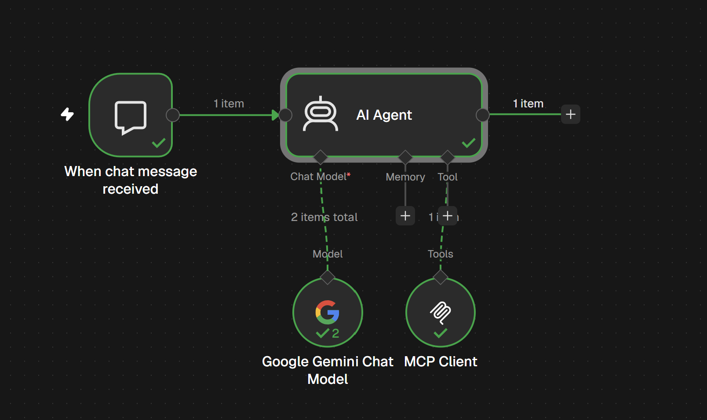
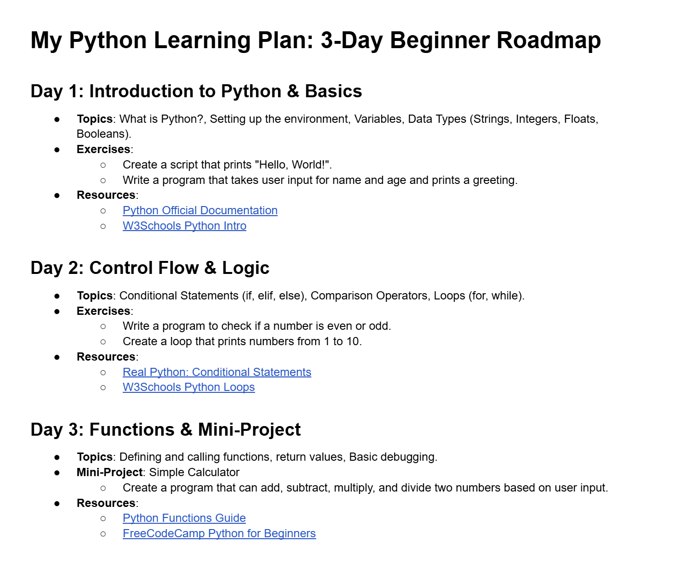

# 🚀 AI Learning Path Generator

An AI-powered Learning Path Generator that creates personalized, day-wise learning roadmaps based on a user's learning goals, current skill level, available study hours, and learning duration.

The application automates curriculum generation, learning resource discovery, Google Docs creation, and study scheduling.

## ✨ Features

- **Personalized Learning Paths:** Generates customized learning roadmaps.
- **Day-wise Curriculum:** Organizes topics, objectives, and practical exercises.
- **Resource Discovery:** Finds relevant YouTube tutorials, official documentation, and free learning resources using SerpAPI.
- **Automated Documentation:** Creates structured learning plans in Google Docs.
- **Study Scheduling:** Integrates Google Calendar to schedule daily learning sessions.
- **AI-powered Generation:** Uses Google Gemini to generate learning plans.

## 🛠️ Tech Stack

| Technology | Purpose |
|---|---|
| n8n | Workflow automation |
| Google Gemini | AI-powered curriculum generation |
| SerpAPI | Learning resource discovery |
| Composio MCP | Tool integration |
| Google Docs | Learning roadmap documentation |
| Google Calendar | Study session scheduling |

## ⚙️ How It Works

1. **User Input:** The user enters a learning goal, skill level, available study hours, and duration.
2. **Curriculum Generation:** Gemini generates a structured day-wise learning plan.
3. **Resource Research:** SerpAPI searches for relevant learning materials.
4. **Google Docs Creation:** The generated curriculum and resources are saved in a Google Doc.
5. **Calendar Scheduling:** Google Calendar is used to schedule daily learning sessions.
6. **Final Output:** The user receives the learning roadmap and scheduling confirmation.


## 🚀 Getting Started

### Prerequisites

- An n8n account
- Google Gemini API key
- SerpAPI API key
- Composio account
- Google account with Docs and Calendar access

### Setup Instructions

1. Clone or download this repository.
2. Import the workflow JSON file into n8n.
3. Configure Google Gemini credentials.
4. Connect Composio MCP and authorize the required Google tools.
5. Configure SerpAPI credentials and search tools.
6. Activate or execute the workflow.
7. Enter your learning goal and generate your personalized roadmap.

## 💡 Example Input

```text
Create a 3-day Python learning path.
I am a beginner and can study 2 hours daily.
Include topics, exercises, and learning resources.
```

## 📌 Expected Output

- Personalized 3-day learning roadmap.
- Daily topics and learning objectives.
- Practical coding exercises.
- Relevant learning resource links.
- Google Docs learning plan.
- Google Calendar study schedule.

## 🔄 Workflow Architecture



## 📸 Project Output




## 🔐 Security

- API keys and authentication tokens should never be committed to GitHub.
- Configure credentials securely inside n8n.
- Use your own API credentials when importing the workflow.

## 🔮 Future Enhancements

- Progress tracking dashboard.
- Learning completion reminders.
- Adaptive learning recommendations.
- Weekly performance summaries.
- Additional AI model integrations.

## 👩‍💻 Author

**Santhoshini Amberkar**


⭐ If you find this project interesting, feel free to explore and contribute!
